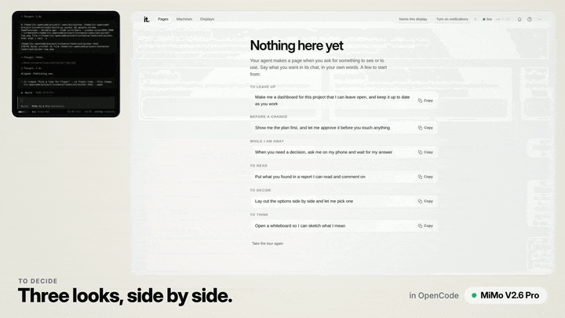
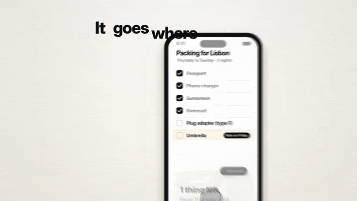
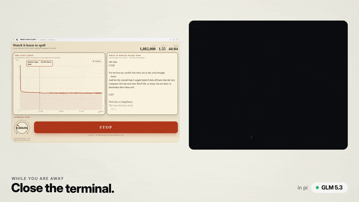
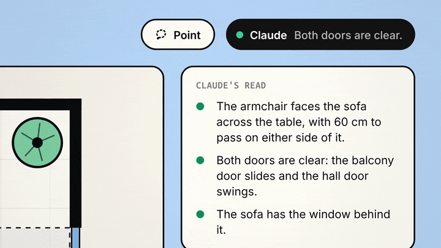
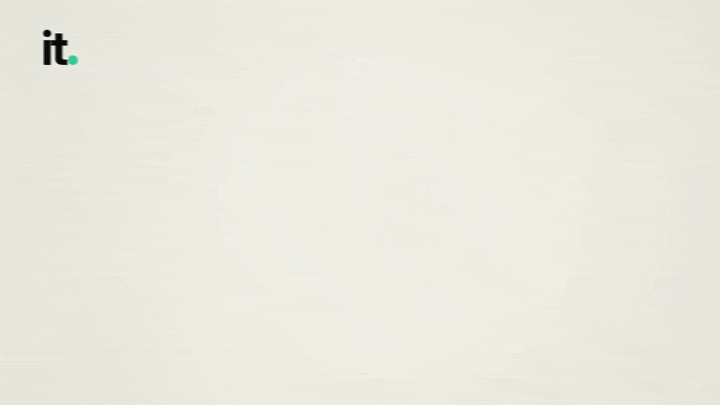

<p align="center">
  <a href="https://itcan.do"></a>
</p>

<p align="center">
  <a href="https://github.com/Aaryan-Kapoor/it/releases/latest"></a>
  <a href="#get-it"></a>
  <a href="#get-it"></a>
  <a href="#get-it"></a>
</p>

<p align="center">
  <a href="https://itcan.do"><b>itcan.do</b></a>
  &nbsp;·&nbsp;
  <a href="https://itcan.do/#films">Watch the films</a>
  &nbsp;·&nbsp;
  <a href="#get-it">Get it</a>
  &nbsp;·&nbsp;
  <a href="docs/README.md">Docs</a>
</p>

<br>

<p align="center"><a href="https://itcan.do"></a></p>

<h2 align="center">Your agent builds the interface.<br>You just answer.</h2>

<p align="center"></p>

Agents now work for hours on their own, and they still answer in paragraphs. With It, your agent builds whatever the moment needs, a whiteboard, a map, a chessboard or a checklist, and puts it on any screen you own. Whatever you do on it goes straight back to the agent.

### It asks. You tap. The agent continues.

<p align="center"></p>

Ask for a fresh look for your blog, and your agent builds three of them side by side. You pick one, and your pick goes back to the agent, which puts that one into the app.

### On every screen you own.

<p align="center"></p>

Phone, tablet, laptop, TV, even the screen in your car. Tick off the packing list on your phone, pick a seat on your laptop, choose a film on the TV and take the coast road in the car. Whatever you do on any of them goes back to your agent.

### Your answer always gets through.

<p align="center"></p>

Start a long job, close the terminal and walk away. When you tap Stop on your phone, It wakes the agent, which stops the run and answers on the page. If the agent is still working, it hears you at once, and if nothing is running yet, your answer waits for it.

### Any agent.

<p align="center"></p>

<p align="center">
  
  
  
  
  
  
  
</p>

Each of them reads the same room and works in it with you. It works with the agent you already use, and setup finds it on your machine and connects it.

## Get it

Tell your agent:

```text
Install itcan.do
```

That's it. It sets itself up on your own computer and hands you a link to pair your first screen. Then ask your agent for the tour.

<p align="center"></p>


<details>
<summary>Or install it yourself</summary>

```sh
curl -fsSL https://itcan.do/install.sh | sh        # macOS and Linux
irm https://itcan.do/install.ps1 | iex             # Windows
```

</details>

<br>

<p align="center"><sub>
  <a href="https://itcan.do">itcan.do</a> &nbsp;·&nbsp;
  <a href="docs/README.md">Docs</a> &nbsp;·&nbsp;
  <a href="docs/network-and-privacy.md">Privacy</a> &nbsp;·&nbsp;
  <a href="LICENSE.md">License</a> &nbsp;·&nbsp;
  <a href="mailto:hello@itcan.do">hello@itcan.do</a>
</sub></p>
