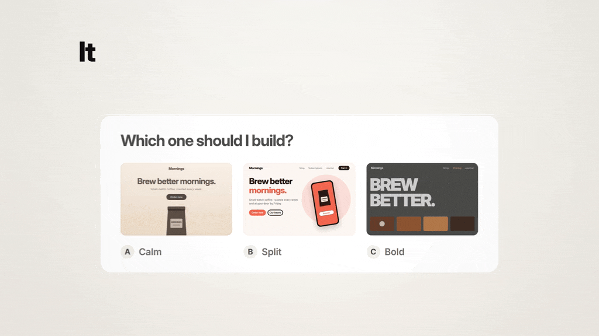

<p align="center"><a href="https://itcan.do"></a></p>

<h3 align="center"><a href="https://itcan.do">itcan.do</a></h3>

<p align="center"><a href="#install">Install</a> · <a href="#read-more">Read more</a></p>

# It

**The first AI workspace for your agent.**

1. **You ask.** In the agent you already use: Claude Code, Codex, T3 Code, Pi, OpenCode or Hermes Agent.
2. **Your agent builds the workspace.** A live page made for that job, on any screen you own.
3. **You work in it together.** What you do on the page goes straight back to your agent, and it answers on the page. It works both ways.

Come back hours later and use the page, and It picks the conversation up where you left it.

It runs on your own computer. See what else it can be, and how to start, at **[itcan.do](https://itcan.do)**.

## Install

Tell your agent:

> Install itcan.do

Or install it yourself:

```sh
curl -fsSL https://itcan.do/install.sh | sh        # macOS and Linux
irm https://itcan.do/install.ps1 | iex             # Windows
```

Then say "Give me the It tour" to your agent.

## Good to know

- **It is made for one person**, on their own computer and their home network. It is not made for the public internet. [What It protects, and what it does not](docs/what-it-protects.md) lists every limit. It comes as it is, with no warranty.
- **It can pick a closed conversation up again** when you use one of its pages, and the page's bar lets you stop it. You turn that off on the Machines page.

## Read more

[Installing It](docs/install.md) · [Screens](docs/screens.md) · [Agents](docs/agents.md) · [What It keeps](docs/data.md) · [Network and privacy](docs/network-and-privacy.md) · [When something does not work](docs/troubleshooting.md) · [Contributing](docs/CONTRIBUTING.md) · [Reporting a security problem](docs/SECURITY.md) · [Third-party notices](THIRD_PARTY_NOTICES.md)
