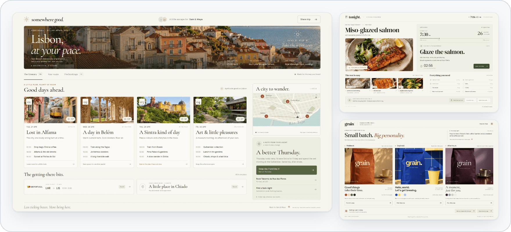
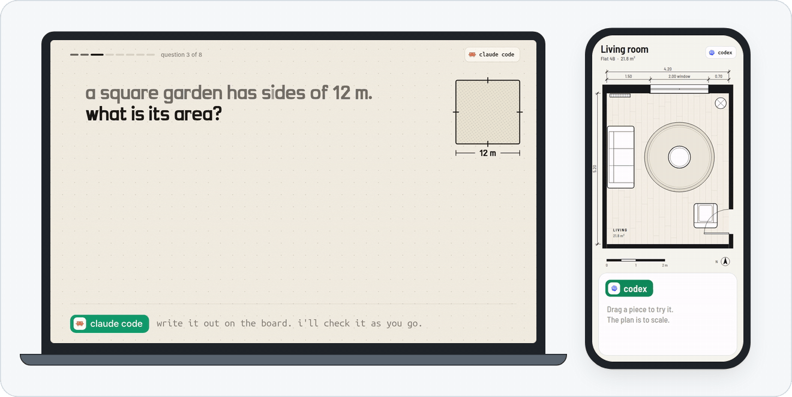
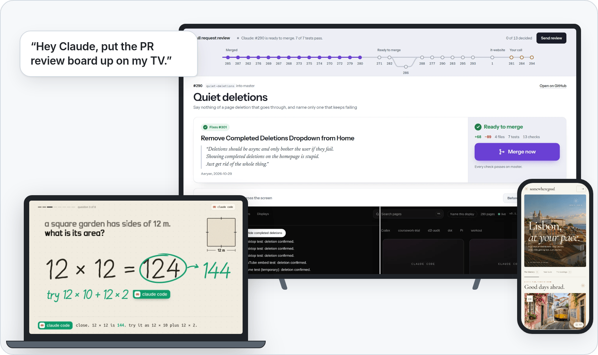
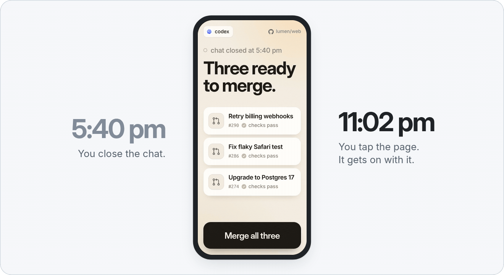
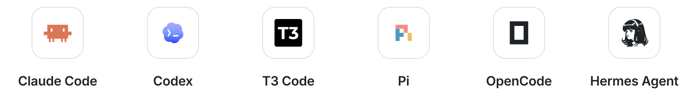
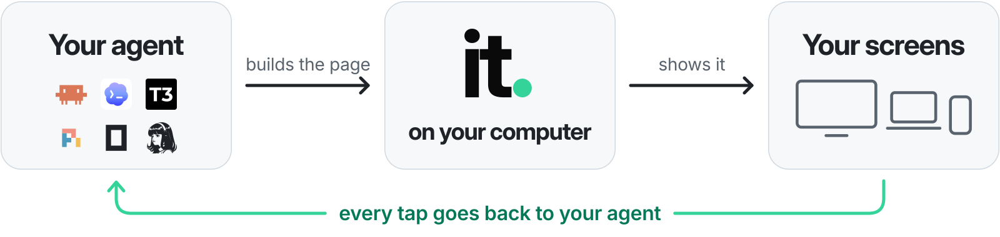
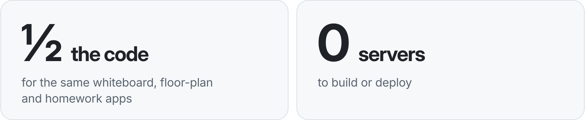

<p align="center">
  <a href="https://itcan.do">
    <picture>
      <source media="(prefers-color-scheme: dark)" srcset="docs/assets/hero-dark.svg">
      
    </picture>
  </a>
</p>

<p align="center">
  <a href="https://github.com/Aaryan-Kapoor/it/releases/latest"></a>
  <a href="#install"></a>
  <a href="docs/licensing.md"></a>
</p>

<p align="center">
  <a href="https://itcan.do"><b>itcan.do</b></a>
  &nbsp;·&nbsp;
  <a href="#install">Install</a>
  &nbsp;·&nbsp;
  <a href="https://itcan.do/#films">Watch the film</a>
  &nbsp;·&nbsp;
  <a href="docs/README.md">Docs</a>
</p>

<br>

<picture>
  <source media="(prefers-color-scheme: dark)" srcset="docs/assets/pages-dark.png">
  
</picture>

### Built for the task, and two-way

Your agent builds the page the job needs, like a whiteboard, a floor plan or a review, then works on it with you and answers on the page.

<picture>
  <source media="(prefers-color-scheme: dark)" srcset="docs/assets/two-way-dark.gif">
  
</picture>

### On the screen it belongs on

Say “Hey Claude, put the PR review board up on my TV,” and there it is. Pages go on any screen you own: your laptop, your phone, your TV, or any browser you pair.

<picture>
  <source media="(prefers-color-scheme: dark)" srcset="docs/assets/screens-dark.png">
  
</picture>

### Even after you've closed the chat

A tap on the page hours later reopens the same agent on your computer, with what it knew, and it gets on with it.

<picture>
  <source media="(prefers-color-scheme: dark)" srcset="docs/assets/after-the-chat-dark.gif">
  
</picture>

### Whichever agent you use

It works with Claude Code, Codex, T3 Code, Pi, OpenCode and Hermes Agent, and you can hand a page from one agent to another.

<picture>
  <source media="(prefers-color-scheme: dark)" srcset="docs/assets/agents-dark.svg">
  
</picture>

## How it works

<picture>
  <source media="(prefers-color-scheme: dark)" srcset="docs/assets/how-it-works-dark.svg">
  
</picture>

It runs on your own computer, beside your agent. Your agent builds the page, It shows it on your screens, and every tap goes back to the agent. Your computer has to be on. Screens join over your home network, or from anywhere over Tailscale.

<picture>
  <source media="(prefers-color-scheme: dark)" srcset="docs/assets/numbers-dark.svg">
  
</picture>

## Install

Paste this to your agent:

```text
Install It from https://itcan.do and set it up on this computer.
```

Or install it yourself. On macOS and Linux:

```text
curl -fsSL https://itcan.do/install.sh | sh
```

On Windows, in PowerShell:

```text
irm https://itcan.do/install.ps1 | iex
```

Then ask your agent for the first thing: **“Give me the It tour.”**

> [!NOTE]
> It is used every day on Linux, and has only been run on test machines on macOS and Windows so far.

## Learn more

- [Screens](docs/screens.md): pairing a phone, a tablet or a TV, and reaching It over your network or Tailscale.
- [Agents](docs/agents.md): connecting the agent apps you use.
- [What It protects, and what it does not](docs/what-it-protects.md), with every limit in full.
- [Network and privacy](docs/network-and-privacy.md): what leaves your computer, and what It fetches.
- [Usage reporting](docs/usage-reporting.md): every count It sends, and what it never sends.
- [All of the docs](docs/README.md), from installing to when something does not work.

## License

It is source-available. You can use it for as long as you like, for your own work too, and change it. [What the license lets you do](docs/licensing.md) explains it with examples, and [LICENSE.md](LICENSE.md) is the license itself.

Pull requests are welcome, and [CONTRIBUTING.md](docs/CONTRIBUTING.md) says how to build It and run the tests. To report a security problem, follow [SECURITY.md](docs/SECURITY.md).

<br>

<p align="center">
  <picture>
    <source media="(prefers-color-scheme: dark)" srcset="docs/assets/sign-off-dark.svg">
    
  </picture>
</p>

<p align="center"><sub>
  <a href="https://itcan.do">itcan.do</a> &nbsp;·&nbsp;
  <a href="mailto:hello@itcan.do">hello@itcan.do</a> &nbsp;·&nbsp;
  Formerly Surface
</sub></p>
